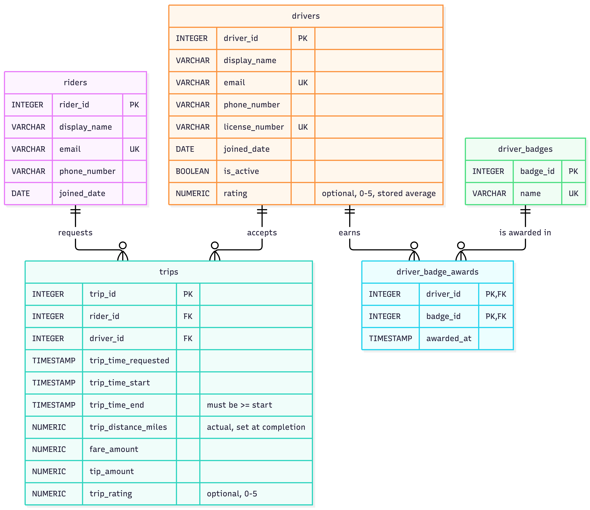

# Ride Sharing Database

A PostgreSQL database for storing and analyzing ride-sharing data: riders, drivers, trips, and the badges drivers earn.

**Theme:** Ride Sharing

## Domain

This database covers the basics of a ride-sharing platform: riders, drivers, trips, badges, and the awards table that ties drivers to the badges they've earned. Riders request trips and drivers accept them. Each trip records when it was requested, when it started and when it ended, plus the real distance, the fare, any tip, and an optional rating from the rider. Drivers also have an active status and a rating, and they can earn badges over time.

The whole point is to make the data easy to ask questions of. For example: how many trips has a driver completed, how much do their fares add up to, which riders actually take trips, who's active right now, how long do trips take, and which badges has a driver earned. The schema is built so those queries stay simple and don't need any hoops.

## Schema



The full DDL is in [`schema/schema.sql`](schema/schema.sql). Detailed attribute definitions are in [`schema/schema-definition.md`](schema/schema-definition.md), and every constraint with its reasoning is in [`schema/constraints.md`](schema/constraints.md). The diagram source is [`schema/erd.mmd`](schema/erd.mmd).

| Table | Role | Purpose |
|---|---|---|
| `riders` | actor | People who take trips |
| `drivers` | producer | People who complete trips; carry `is_active` and `rating` |
| `trips` | event | One row per trip: rider, driver, times, distance, fare, tip, rating |
| `driver_badges` | catalog | The badges that exist |
| `driver_badge_awards` | junction | Which driver earned which badge, and when |

**Design decisions to notice**

- **Surrogate keys:** every entity uses a generated integer key (`GENERATED ALWAYS AS IDENTITY`), because display names can be shared or changed and emails change too.
- **RESTRICT on every foreign key:** trips and awards are history. A rider, driver or badge with activity can't be hard-deleted, and `drivers.is_active` is how a driver gets taken offline. If someone wants their data removed, the plan is to anonymize their personal fields and keep the row.
- **Composite key on awards:** `(driver_id, badge_id)` stops the same badge being awarded to a driver twice. `awarded_at` sits on that table because it's about the pairing.
- **Rules live in the schema:** ratings must be 0 to 5, fares and tips can't be negative, and a trip can't start before it was requested or end before it started.
- **Derived stuff is computed, with one exception:** trip duration and all the counts and totals are worked out at query time. The only stored derived value is `drivers.rating`, which is a deliberate shortcut and is kept up to date by the application.
- **Indexes on foreign keys:** Postgres doesn't create these automatically, so `trips.rider_id`, `trips.driver_id` and `driver_badge_awards.badge_id` are indexed by hand.

The reasoning behind all of this is in [`analysis/unit2.md`](analysis/unit2.md).

## How to run it

You need PostgreSQL 14 or later and an empty database.

```bash
createdb ridesharing
psql -d ridesharing -f schema/schema.sql
psql -d ridesharing -c "\dt"
```

The script starts with a reset block, so you can run it again on the same database without cleaning anything up first.

## Course query catalogue — Units 3 and 4

The schema and setup instructions above describe my **Unit 2 database**. For Units **3 and 4**, the course supplied a separate ride-sharing dataset, [`rideshare.sql`](rideshare.sql), used in the `ex603_data` PostgreSQL database. Its tables and fields are not necessarily the same as my Unit 2 design. For the course dataset, the failure being audited is **a rider no-show**, recorded as `cancellation_reason = 'Rider no show'`.

To load the course dataset into a new database, from the folder containing `rideshare.sql`:

```bash
createdb ex603_data
psql -d ex603_data -f rideshare.sql
psql -d ex603_data -c "SELECT COUNT(*) FROM trips;"
```

The final check should return **200 trips**. The dataset script drops and recreates its tables on each run, so don't reload it into a database containing work you need to keep. The Unit 4 files contain read-only `SELECT` queries; run them against this course dataset, not the Unit 2 schema. Some Unit 3 files deliberately demonstrate a **broken** query before showing its repair, so those examples are not intended to execute successfully as a single uninterrupted script.

### Unit 3 — Interrogating the Data

**[`queries/unit3/q3_1.sql`](queries/unit3/q3_1.sql) — Explore what the data contains**

| Query | Business question |
|---|---|
| Setup check | Did the course dataset load with the expected number of records in each table? |
| 3.1a | Which active drivers have a rating of at least 4.5? |
| 3.1b-1 | Which trip statuses exist in the data? |
| 3.1b-2 | Which cancellation reasons appear under each trip status? |
| 3.1c-1 | Which trips have fares of $5 or less? |
| 3.1c-2 | Which trips were cancelled or disputed rather than completed? |
| 3.1d-1 | Which drivers' recorded names end in the digit 1? |
| 3.1d-2 | Which trips have no cancellation reason on file? |
| 3.1d-3 | Were any cancelled trips recorded without a cancellation reason? |
| 3.1e-1 | What percentage of trips were completed, cancelled, or disputed? |
| 3.1e-2 | What percentage of all trips were rider no-shows? |

**[`queries/unit3/q3_2.sql`](queries/unit3/q3_2.sql) — Identify and repair the dashboard errors**

| Query | Business question |
|---|---|
| 3.2A-1 | How can a seemingly sensible cancellation filter silently omit trips? *(Intentional logic bug.)* |
| 3.2A-2 | How many trips did that filter silently omit? |
| 3.2A-3 | How do the excluded, included and NULL-reason counts reconcile to the platform total? |
| 3.2A-4 | How can an explicit NULL check repair the incorrect count? |
| 3.2A-5 | Can `COALESCE` produce the same correct count? |
| 3.2B-1 | What happens when a filter refers to an output label before SQL has created it? *(Intentional SQL error.)* |
| 3.2B-2 | How can repeating an expression fix the label problem? |
| 3.2B-3 | How can a CTE fix the same problem? |

**[`queries/unit3/q3_3.sql`](queries/unit3/q3_3.sql) — Verify equivalent answers**

| Query | Business question |
|---|---|
| 3.3a | Which drivers had rider no-shows, and how many? *(Subquery with `IN`.)* |
| 3.3b | Can the same driver/no-show answer be obtained with a CTE? |
| 3.3c | Can the answer also be obtained using `EXISTS`? |
| 3.3d | Do the three approaches return the same driver records and no-show counts? |
| 3.3e | Under what NULL-related condition can a negative membership check give a different result? |

The Unit 3 leadership-facing audit is in [`analysis/unit3-finding.md`](analysis/unit3-finding.md).

### Unit 4 — From Rows to Insight

**[`queries/unit4/q4_1.sql`](queries/unit4/q4_1.sql) — Measure the platform**

| Query | Business question |
|---|---|
| 1a — Required | Across all trips, what are the fare count, total, average, minimum, maximum and number of distinct riders? |
| 1b — Supplementary | How do those numbers change when $0 fares are excluded? |
| 1c — Supplementary | Which trip outcomes account for the zero-fare records? |
| 2a — Required | Which drivers handled the most trips, and what were their average recorded fares? |
| 2b — Supplementary | How do drivers' positive-fare trip counts and averages compare? |
| 3 — Required | Which drivers meet a trip-volume cutoff for comparing no-show rates? |
| 4a — **Primary regional view** | How do trips, fares and no-show rates vary by driver and **pickup region**? |
| 4b — Supplementary | How do the same measures vary by driver and **pickup city**? |
| 4c — Alternative responsibility view | How would these drivers' records be grouped by **home region**? |
| 4d — Alternative responsibility view | How would these drivers' records be grouped by **home city**? |
| 4e — Supplementary verification | How often do pickup and driver-home locations match by city or region? |

**[`queries/unit4/q4_2.sql`](queries/unit4/q4_2.sql) — Build the leadership breakdown**

| Query | Business question |
|---|---|
| Part A — Required | How many trips and rider no-shows did each driver have, side by side? |
| Part B1 — **Primary ROLLUP** | What are the pickup-region subtotals and platform grand total, without detailed city rows? |
| Part B2 — Supplementary ROLLUP | Which pickup cities have higher or lower no-show rates than the entire platform? |
| Part C — Required | Among busier drivers, what share of trips were no-shows, and who is above that group's rate? |
| D1 — Exploratory | Which riders had more than one no-show, and were different drivers involved? |
| D2 — Exploratory | How do recorded no-show rates vary by surge multiplier? |

For the written discussion of the aggregate results, geographic choices, threshold and reflection, see [`analysis/unit4.md`](analysis/unit4.md). The leadership brief is [`analysis/unit4-finding.md`](analysis/unit4-finding.md). Query-and-result screenshots are in [`screenshots/`](screenshots/), named to match the query each one shows. The regional subtotal and grand-total rows are explicitly labeled in the Part B1 output.
