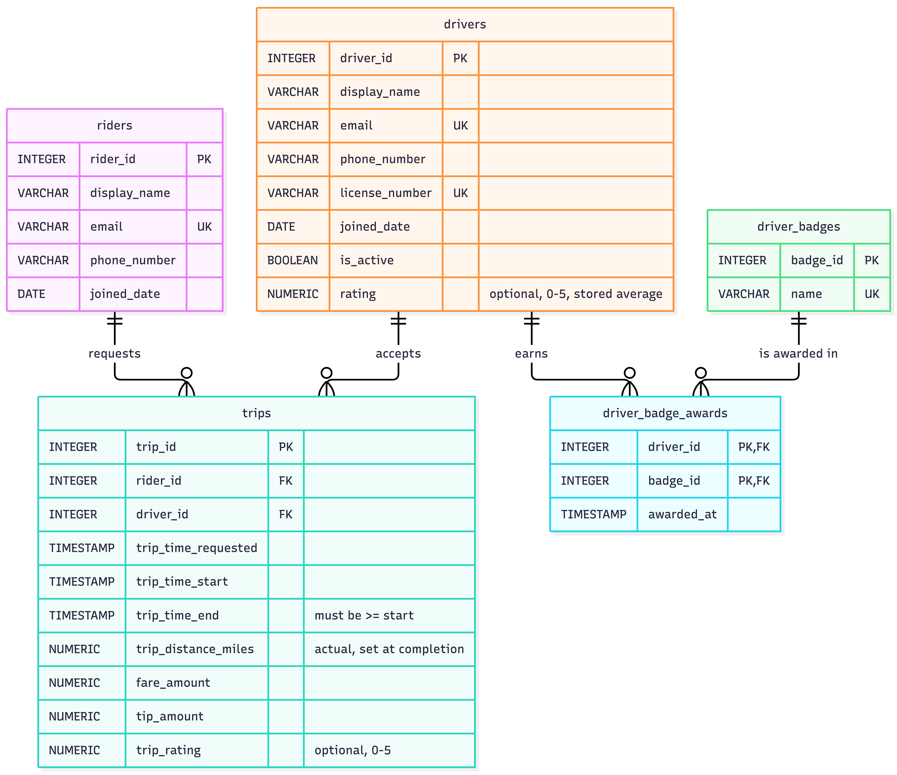
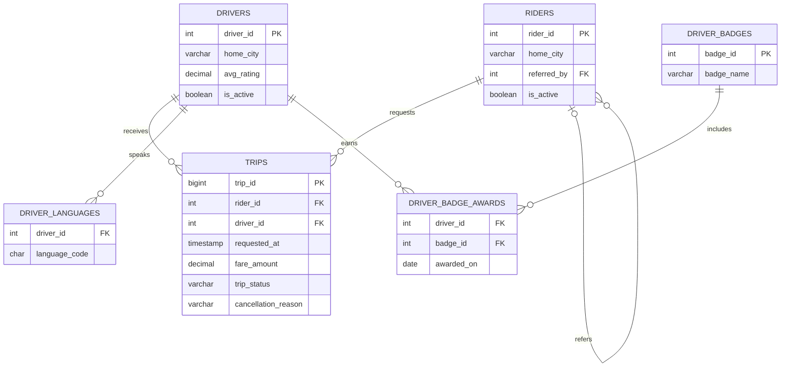

# Ride Sharing Database

A PostgreSQL ride-sharing project combining a custom database design (Units 1–2) with SQL analysis of a separate course-provided dataset (Units 3–6), focused on rider no-shows.

**Theme:** Ride Sharing

## Domain

This database covers the basics of a ride-sharing platform: riders, drivers, trips, badges, and the awards table that ties drivers to the badges they've earned. Riders request trips and drivers accept them. Each trip records when it was requested, when it started and when it ended, plus the real distance, the fare, any tip, and an optional rating from the rider. Drivers also have an active status and a rating, and they can earn badges over time.

The whole point is to make the data easy to ask questions of. For example: how many trips has a driver completed, how much do their fares add up to, which riders actually take trips, who's active right now, how long do trips take, and which badges has a driver earned. The schema is built so those queries stay simple and don't need any hoops.

For Units 3–6, I used a separate ride-sharing dataset supplied by the course. The central question became whether rider no-shows were improving or getting worse, which drivers or riders warranted closer review, and what the team should do next. I started by checking an incorrectly calculated failure rate, then used grouped summaries, joins, and window functions to compare activity across drivers and over time. The two schemas are related by theme, but they are not interchangeable.

## Unit 2: Custom schema

The ERD below shows the database I designed for Unit 2. Units 3–6 use the separate reference schema described later.



The full DDL is in [`schema/schema.sql`](schema/schema.sql). Detailed attribute definitions are in [`schema/schema-definition.md`](schema/schema-definition.md), and every constraint with its reasoning is in [`schema/constraints.md`](schema/constraints.md). The diagram source is [`schema/erd.mmd`](schema/erd.mmd).

| Table | Role | Purpose |
|---|---|---|
| `riders` | actor | People who take trips |
| `drivers` | producer | People who complete trips; carry `is_active` and `rating` |
| `trips` | event | One row per trip: rider, driver, times, distance, fare, tip, rating |
| `driver_badges` | catalog | The badges that exist |
| `driver_badge_awards` | junction | Which driver earned which badge, and when |

**Design decisions to notice**

- **Surrogate keys:** every entity uses a generated integer key (`GENERATED ALWAYS AS IDENTITY`), because display names can be shared or changed and emails change too.
- **RESTRICT on every foreign key:** trips and awards are history. A rider, driver or badge with activity can't be hard-deleted, and `drivers.is_active` is how a driver gets taken offline. If someone wants their data removed, the plan is to anonymize their personal fields and keep the row.
- **Composite key on awards:** `(driver_id, badge_id)` stops the same badge being awarded to a driver twice. `awarded_at` sits on that table because it's about the pairing.
- **Rules live in the schema:** ratings must be 0 to 5, fares and tips can't be negative, and a trip can't start before it was requested or end before it started.
- **Derived stuff is computed, with one exception:** trip duration and all the counts and totals are worked out at query time. The only stored derived value is `drivers.rating`, which is a deliberate shortcut and is kept up to date by the application.
- **Indexes on foreign keys:** Postgres doesn't create these automatically, so `trips.rider_id`, `trips.driver_id` and `driver_badge_awards.badge_id` are indexed by hand.

The reasoning behind all of this is in [`analysis/unit2.md`](analysis/unit2.md).

## How to run it

### Unit 2: Custom schema

You need PostgreSQL 14 or later and an empty database.

```bash
createdb ridesharing
psql -d ridesharing -f schema/schema.sql
psql -d ridesharing -c "\dt"
```

The script starts with a reset block, so you can run it again on the same database without cleaning anything up first.

### Units 3–6: Course dataset

The schema and setup instructions above describe my **Unit 2 database**. For Units **3–6**, the course supplied a separate ride-sharing dataset, [`rideshare.sql`](rideshare.sql), used in the `ex603_data` PostgreSQL database. Its tables and fields are not necessarily the same as my Unit 2 design. For the course dataset, the failure being audited is **a rider no-show**, recorded as `cancellation_reason = 'Rider no show'`.

To load the course dataset into a new database, from the folder containing `rideshare.sql`:

```bash
createdb ex603_data
psql -d ex603_data -f rideshare.sql
psql -d ex603_data -c "SELECT COUNT(*) FROM trips;"
```

The final check should return **200 trips**. The dataset script drops and recreates its tables on each run, so don't reload it into a database containing work you need to keep. The supplied `rideshare.sql` file should be kept unchanged; it creates the reference analytics schema and data, which are separate from my Unit 2 schema. The Unit 4–6 files contain read-only `SELECT` queries; run them against this course dataset, not the Unit 2 schema. Some Unit 3 files deliberately demonstrate a **broken** query before showing its repair, so those examples are not intended to execute successfully as a single uninterrupted script.

To run a Unit 6 query file after loading `ex603_data`, use:

```bash
psql -d ex603_data -f queries/unit6/q6_3.sql
```

You can also run each `SELECT` separately in DataGrip. The SQL files contain multiple independent queries. Unit 6 uses native timestamps and dates and keeps percentage/fare calculations numeric, rounded to two decimal places.

## Units 3–6: Reference database overview

The Unit 3–6 DDL and sample records are in the course-provided [`rideshare.sql`](rideshare.sql), separate from my custom [`schema/schema.sql`](schema/schema.sql). The reference database contains **30 riders, 15 drivers, and 200 trip requests from 2023**, along with driver languages and badges. Its `trips` table records request and completion times, pickup city, fare, distance, surge multiplier, trip status, and cancellation reason. These are the fields used for the failure-rate investigation and later trend analyses.

| Table | Role in the reference dataset | Fields relevant to the analysis |
|---|---|---|
| `riders` | Rider accounts and referrals | `rider_id`, `home_city`, `referred_by`, `is_active` |
| `drivers` | Driver accounts | `driver_id`, `home_city`, `avg_rating`, `is_active` |
| `trips` | Trip requests and outcomes | `rider_id`, `driver_id`, `requested_at`, `fare_amount`, `trip_status`, `cancellation_reason` |
| `driver_languages` | Languages associated with drivers | `driver_id`, `language_code` |
| `driver_badges` | Badge catalogue | `badge_id`, `badge_name` |
| `driver_badge_awards` | Badges awarded to drivers | `driver_id`, `badge_id`, `awarded_on` |

The ERD below summarizes the relationships in the supplied reference schema. `trips` links riders to drivers, `driver_languages` allows a driver to have multiple languages, and `driver_badge_awards` connects drivers with badges. Riders may also refer other riders.



The detailed table definitions, keys, and constraints are in [`rideshare.sql`](rideshare.sql). Unlike the Unit 2 design, the reference schema records cancellation reasons and surge multipliers, which are central to the later assignments. The failure metric throughout Units 3–6 is **rider no-shows divided by all trip requests**, not just completed or cancelled trips.

## Course query catalogue — Units 3–6

### Unit 3 — Interrogating the Data

**[`queries/unit3/q3_1.sql`](queries/unit3/q3_1.sql) — Explore what the data contains**

| Query | Business question |
|---|---|
| Setup check | Did the course dataset load with the expected number of records in each table? |
| 3.1a | Which active drivers have a rating of at least 4.5? |
| 3.1b-1 | Which trip statuses exist in the data? |
| 3.1b-2 | Which cancellation reasons appear under each trip status? |
| 3.1c-1 | Which trips have fares of $5 or less? |
| 3.1c-2 | Which trips were cancelled or disputed rather than completed? |
| 3.1d-1 | Which drivers' recorded names end in the digit 1? |
| 3.1d-2 | Which trips have no cancellation reason on file? |
| 3.1d-3 | Were any cancelled trips recorded without a cancellation reason? |
| 3.1e-1 | What percentage of trips were completed, cancelled, or disputed? |
| 3.1e-2 | What percentage of all trips were rider no-shows? |

**[`queries/unit3/q3_2.sql`](queries/unit3/q3_2.sql) — Identify and repair the dashboard errors**

| Query | Business question |
|---|---|
| 3.2A-1 | How can a seemingly sensible cancellation filter silently omit trips? *(Intentional logic bug.)* |
| 3.2A-2 | How many trips did that filter silently omit? |
| 3.2A-3 | How do the excluded, included and NULL-reason counts reconcile to the platform total? |
| 3.2A-4 | How can an explicit NULL check repair the incorrect count? |
| 3.2A-5 | Can `COALESCE` produce the same correct count? |
| 3.2B-1 | What happens when a filter refers to an output label before SQL has created it? *(Intentional SQL error.)* |
| 3.2B-2 | How can repeating an expression fix the label problem? |
| 3.2B-3 | How can a CTE fix the same problem? |

**[`queries/unit3/q3_3.sql`](queries/unit3/q3_3.sql) — Verify equivalent answers**

| Query | Business question |
|---|---|
| 3.3a | Which drivers had rider no-shows, and how many? *(Subquery with `IN`.)* |
| 3.3b | Can the same driver/no-show answer be obtained with a CTE? |
| 3.3c | Can the answer also be obtained using `EXISTS`? |
| 3.3d | Do the three approaches return the same driver records and no-show counts? |
| 3.3e | Under what NULL-related condition can a negative membership check give a different result? |

The Unit 3 leadership-facing audit is in [`analysis/unit3-finding.md`](analysis/unit3-finding.md).

### Unit 4 — From Rows to Insight

**[`queries/unit4/q4_1.sql`](queries/unit4/q4_1.sql) — Measure the platform**

| Query | Business question |
|---|---|
| 1a — Required | Across all trips, what are the fare count, total, average, minimum, maximum and number of distinct riders? |
| 1b — Supplementary | How do those numbers change when $0 fares are excluded? |
| 1c — Supplementary | Which trip outcomes account for the zero-fare records? |
| 2a — Required | Which drivers handled the most trips, and what were their average recorded fares? |
| 2b — Supplementary | How do drivers' positive-fare trip counts and averages compare? |
| 3 — Required | Which drivers meet a trip-volume cutoff for comparing no-show rates? |
| 4a — **Primary regional view** | How do trips, fares and no-show rates vary by driver and **pickup region**? |
| 4b — Supplementary | How do the same measures vary by driver and **pickup city**? |
| 4c — Alternative responsibility view | How would these drivers' records be grouped by **home region**? |
| 4d — Alternative responsibility view | How would these drivers' records be grouped by **home city**? |
| 4e — Supplementary verification | How often do pickup and driver-home locations match by city or region? |

**[`queries/unit4/q4_2.sql`](queries/unit4/q4_2.sql) — Build the leadership breakdown**

| Query | Business question |
|---|---|
| Part A — Required | Among drivers with recorded trips, how many trips and rider no-shows did each have, side by side? |
| Part B1 — **Primary ROLLUP** | What are the pickup-region subtotals and platform grand total, without detailed city rows? |
| Part B2 — Supplementary ROLLUP | Which pickup cities have higher or lower no-show rates than the entire platform? |
| Part C — Required | Among drivers with more trips than the average driver with trips, what is the group's no-show rate, and whose rate is higher? |
| D1 — Exploratory | Which riders had more than one no-show, and were different drivers involved? |
| D2 — Exploratory | How do recorded no-show rates vary by surge multiplier? |

For the expanded discussion of fare averages, the volume threshold, geographic and driver comparisons, additional rider and surge checks, and the reflection, see [`analysis/unit4.md`](analysis/unit4.md). The leadership report and recommended follow-up investigations are in [`analysis/unit4-finding.md`](analysis/unit4-finding.md). Query-and-result screenshots are in [`screenshots/`](screenshots/), named to match the query each one shows. The regional subtotal and grand-total rows are explicitly labeled in the Part B1 output.


### Unit 5 — Connecting the Tables

**[`queries/unit5/q5_1.sql`](queries/unit5/q5_1.sql) — Add people, badges, and peer comparisons**

| Query | Business question |
|---|---|
| Part 1 — Required | Which rider and driver are associated with each trip? (Three-table join.) |
| Part 2a/2b | Which badges do the previously flagged drivers hold, and what do those awards actually show? |
| Part 3a/3b | How do drivers compare with peers from the same home city or with similar recorded trip counts? |

**[`queries/unit5/q5_2.sql`](queries/unit5/q5_2.sql) — Find rows that joins can miss**

| Query | Business question |
|---|---|
| Part A — Required | Which drivers disappear from an `INNER JOIN` because they have no trips? |
| Part B | Do `LEFT JOIN`, `RIGHT JOIN`, and `FULL OUTER JOIN` tell the same story about missing records? |
| Part C | Can `NOT EXISTS` and `EXCEPT` identify drivers without trips consistently? |

**[`queries/unit5/q5_3.sql`](queries/unit5/q5_3.sql) — Understand join behavior and performance**

| Query | Business question |
|---|---|
| CROSS JOIN examples | When is every possible driver/badge combination useful, and when would a Cartesian product be a mistake? |
| Execution plan | Which join methods did PostgreSQL use for the three-table trip report, and why? |

See the detailed discussion in [`analysis/unit5.md`](analysis/unit5.md) and the leadership conclusions in [`analysis/unit5-finding.md`](analysis/unit5-finding.md). These files preserve the earlier finding that **Drivers 14 and 15** have no recorded trips in the 2023 extract, despite being marked active.

### Unit 6 — Analytics and Window Functions

**[`queries/unit6/q6_1.sql`](queries/unit6/q6_1.sql) — Compare, rank, and form quartiles**

| Query | Business question |
|---|---|
| 1a — Required | Which trips are far from their own driver's average fare without losing individual rows? |
| 1b — Required | What disappears when the same comparison starts with `GROUP BY`? |
| 2 — Required | How do `ROW_NUMBER()`, `RANK()`, and `DENSE_RANK()` differ when driver trip counts tie? |
| 3 — Required | Where does `NTILE(4)` put equally active drivers at a quartile boundary? |

**[`queries/unit6/q6_2.sql`](queries/unit6/q6_2.sql) — Compare neighbors and track progress**

| Query | Business question |
|---|---|
| 1 / Part A — Required | How did Driver 2's recorded fare change from one trip to the next (`LAG`/`LEAD`)? |
| 2a / Part B — Required | How did monthly request counts accumulate toward an illustrative target? |
| 2b / Part B — Required | How did monthly recorded fares accumulate toward an illustrative target? |
| 2c / Part B — Required | What does a three-month moving average show about trip volume? |
| 2d / Part B — Required | What does the same moving window show about recorded fares, and how does `ROWS` differ from `RANGE`? |
| 3 / Part C — Required | Which drivers have gaps of 60 or more full days between recorded trips? |

**[`queries/unit6/q6_3.sql`](queries/unit6/q6_3.sql) — Build reporting patterns**

| Query | Business question |
|---|---|
| 1 / Part A — Required | Which are each driver's three highest recorded fares, relative to that driver's maximum? |
| 2a / Part B — Required | Is the monthly rider no-show rate getting better or worse, and are any calendar months missing? |
| 2b — Supporting Task 6.4 | How did the rider no-show rate move quarter by quarter? |
| 2c — Supporting Task 6.4 | What does a correctly weighted trailing three-month no-show rate show? |
| 2d — Supporting Task 6.4 | Did the earlier flagged drivers show the same first-half/second-half trend as other drivers? |
| Extra 1 — Supporting Task 6.4 | Which twelve actual trips should Driver Operations and Rider Support review? |

The detailed answers and 150–250-word reflection are in [`analysis/unit6.md`](analysis/unit6.md); the final recommendations are in [`analysis/unit6-finding.md`](analysis/unit6-finding.md). Screenshot names can follow the earlier Unit 5 underscore convention, such as `6_1_1a`, `6_2_2c`, `6_3_2a`, and `6_3_extra1` for the optional review list.

## Technical Highlights

**Finding the dashboard's silent `NULL` bug (Unit 3).** A filter that appeared to exclude rider no-shows also silently excluded most trips with a NULL cancellation reason. Correcting the denominator gave the true **12 no-shows in 200 trips (6.00%)**, rather than the misleading dashboard rate. The deliberate broken queries remain in the Unit 3 files as examples, clearly labeled.

**Conditional aggregation and regional reporting (Unit 4).** Counting all trips alongside `Rider no show` outcomes keeps zero-failure groups in the result. Driver summaries, regional `ROLLUP` subtotals, and a separate high-volume baseline helped distinguish observed rates from the very small histories that make some percentages misleading.

**Joins and missing records (Unit 5).** An `INNER JOIN` starting from trip records shows only **13** of the **15** drivers. `LEFT JOIN`, `NOT EXISTS`, and `EXCEPT` explain why Drivers **14 and 15** are absent from event-based reports. `EXPLAIN` was used to inspect the actual join plan rather than guessing how PostgreSQL executed it.

**Window functions and explicit window frames (Unit 6).** `AVG(...) OVER (PARTITION BY driver_id)` places each driver's average on all **200** trip rows. `LAG()`/`LEAD()` compare neighboring trips; `ROWS BETWEEN` frames build running totals and moving averages without losing the monthly sequence. A CTE computes ranks or gaps before an outer `WHERE` filters them, because window results cannot be filtered by `WHERE` in the same SELECT.

**Reproducible ranking without pretending ties are resolved fairly (Unit 6).** We added `driver_id` only as a reproducible tie-breaker in `ROW_NUMBER()` and `NTILE(4)`. If omitted, tied drivers' unique positions or quartile assignments might switch on rerun. The limitation remains: equal trip counts can receive different row numbers or fall into different quartiles. `RANK()` and `DENSE_RANK()` deliberately use trip counts alone and preserve genuine ties. For neighboring trip comparisons, `trip_id` consistently breaks equal timestamps in `LAG()`/`LEAD()` so the fare and its delta refer to the same preceding or following row.

## Findings and Recommendations

**The rider no-show failure rate was initially overstated.** Across 2023, the corrected figure is **12 of 200 trip requests (6.00%)**. This does not justify an automatic fleet-wide payout freeze. Keep the failure definition, denominator, and NULL-handling checks explicit before using the rate for management decisions.

**Drivers 2 and 3 deserve targeted investigation; Driver 4 needs more observations.** Driver 2 recorded **3 rider no-shows in 16 trips (18.75%)**, Driver 3 **2 in 13 (15.38%)**, and Driver 4 **1 in just 6 (16.67%)**. The apparent rates are not proof of driver fault. Unit 4 also found repeat no-shows involving Riders 1 and 21. Driver Operations and Rider Support should review the underlying pickup events together. Drivers 14 and 15, who had no recorded trips, need a separate account/dispatch check rather than an invented 0% performance rating.

**There is some improvement across quarters, but monthly rates remain noisy.** The observed rider no-show rate declined from **7.55% in Q1** to **4.17% in Q4**, while **December rebounded to 12.50%** after October and November were at zero. The twelve-event numerator is too small to claim a lasting trend. Keep counts beside rates, check for missing months, use a weighted rolling rate for context, and review the individual trips rather than making a decision from a one-month spike. See [`analysis/unit6-finding.md`](analysis/unit6-finding.md).

## Limitations and Future Improvements

The reference dataset contains only **200 trip requests** and **12 rider no-shows** over one year. A change of one or two events can move a monthly percentage sharply, and no rate here establishes that a driver caused a no-show. The `trips` table also lacks driver online time, confirmed pickup arrivals, wait durations, support communications, and actual payment/refund records. Without those, we cannot determine whether long activity gaps reflect real absence, low demand, or missing records—or calculate actual revenue lost to cancelled trips. Additional historical trips and pickup/availability/payment telemetry would make next-quarter decisions more reliable.

## Video Presentation

**Video link:** *[placeholder]*
